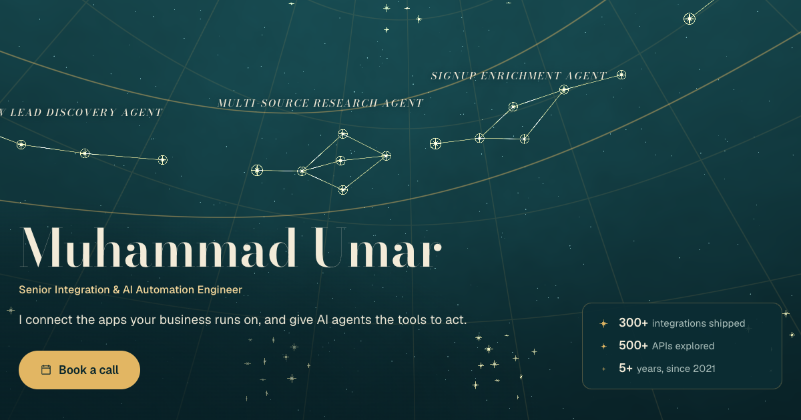

# Muhammad Umar, portfolio v4

**Live:** https://umar8092.github.io/portfolio-v4/

Every app I've integrated is a gold star on a terminal ceiling (300 of them, from Salesforce to Xero), and every system I've built is a constellation drawn between them. Pick a case study and its stars leave the sky and line up as the real pipeline, with data pulses running along the gold lines.



## What's on the page

- **The sky.** A WebGL dome in teal plaster and gold leaf: a celestial grid, a band of ten constellations (one per case study) and 300 app stars grouped by category. Hover a star to read its name.
- **Find your app.** Search the catalog and the sky turns to that app's star. Browse 22 categories, billed by how many apps each holds.
- **Ten systems.** Four AI agents built on Squig and six integrations built on Integry. Each one becomes its pipeline diagram with a step-by-step run log, and links to its full case study.
- **Platforms, experience, free apps.** The six platforms ranked by case studies, the 2021 to 2026 timeline drawn on an arc, and the free apps feed read live from [umar8092.github.io/apps](https://umar8092.github.io/apps/).
- **Night sky and day atlas.** A labelled switch flips between the night ceiling and a printed star atlas; the choice is remembered.

Works without WebGL (static sky), respects reduced motion, and has no sideways scroll from 320px to 1920px wide.

## Run it locally

```bash
git clone https://github.com/umar8092/portfolio-v4.git
cd portfolio-v4
python3 -m http.server 8780
# open http://localhost:8780/
```

No build step: plain HTML, CSS and ES modules.

## How it is built

| Part | File |
|---|---|
| Content and structure | `index.html` |
| Night and day tokens, layout | `css/site.css` |
| The sky (dome shader, stars, constellations, pipeline morph) | `js/sky.js` |
| Sections, search, scroll choreography, live apps feed | `js/main.js` |
| Case studies, catalog, logos | `js/data.js` |

## Credits

- [three.js](https://threejs.org) (MIT), [GSAP and ScrollTrigger](https://gsap.com) (GSAP standard licence), [Lenis](https://lenis.darkroom.engineering) (MIT), vendored in `vendor/`.
- Fonts: [Bricolage Grotesque](https://fonts.google.com/specimen/Bricolage+Grotesque), [Schibsted Grotesk](https://fonts.google.com/specimen/Schibsted+Grotesk) and [Fragment Mono](https://fonts.google.com/specimen/Fragment+Mono) (SIL Open Font License), self-hosted.
- Icons: [Phosphor Icons](https://phosphoricons.com) (MIT).
- App and company logos belong to their owners and are shown to name the apps I have integrated.

Book a call: https://cal.com/muhammad-umar-8092/15min
